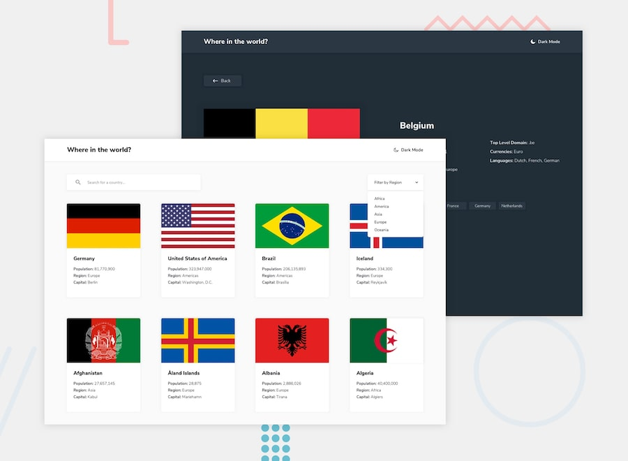

# Frontend Mentor - REST Countries API with color theme switcher



## Table of contents

- [Overview](#overview)
  - [The challenge](#the-challenge)
  - [Links](#links)
- [My process](#my-process)
  - [Built with](#built-with)
  - [What I learned](#what-i-learned)
- [Author](#author)

## Overview

### The challenge

My challenge was to build a single-page app with two views on top of the live [REST Countries API](https://restcountries.com) and get it looking as close to the Figma design as possible on desktop, tablet and mobile. The index view lists every country in the world (or a single region) with a search bar and a region dropdown. Clicking a country opens a detail view, and a back button returns to the index. The app has a light theme and a dark theme.

Your users should be able to:

- See all countries from the API on the homepage
- Search for a country by name using an `input` field
- Filter countries by region
- Click on a country to see more detailed information on a separate view
- Click through to the border countries on the detail view
- Toggle the color scheme between light and dark mode
- View the optimal layout depending on their device's screen size
- See hover, focus and active states for all interactive elements

### Links

- Live Site URL: [github pages](https://gerardocianciulli.github.io/rest-countries-api-with-color-theme-switcher/)

## My process

### Built with

- Semantic HTML5 markup
- CSS custom properties
- CSS Grid
- Flexbox
- Media queries (desktop-first, `rem` units throughout)
- [React](https://react.dev/)
- [TypeScript](https://www.typescriptlang.org/)
- [Vite](https://vite.dev/)
- [vite-plugin-svgr](https://github.com/pd4d10/vite-plugin-svgr) for SVG icons
- [jQuery](https://jquery.com/) for the button and dropdown interactions
- Fetch API with the [REST Countries API v5](https://restcountries.com)
- [gh-pages](https://github.com/tschaub/gh-pages) for deployment

### What I learned

**Importing SVGs as React components.** With `vite-plugin-svgr`, adding `?react` to an SVG import turns it into a component I can style with CSS. The theme toggle uses one moon icon, outlined in light mode and filled in dark mode, with no second asset:

```tsx
import MoonIcon from '../icons/moon.svg?react';

<MoonIcon className="theme-toggle__icon" aria-hidden="true" focusable="false" />
```

```css
.theme-toggle__icon path { fill: transparent; }
[data-theme='dark'] .theme-toggle__icon path { fill: currentColor; }
```

**Paginating with `limit` and `offset`.** The API returns at most 25 countries per request, so I loop through the pages and append each one to a local array. The UI renders after every page instead of waiting for all ~250 countries. One gotcha: `offset` counts *items*, not pages, so the page number has to be multiplied by the page size:

```ts
for (let page = 0; page < MAX_PAGES; page += 1) {
  const { objects, meta } = await fetchPage(region, page); // offset = page * 25
  for (const raw of objects) {
    const country = toCountry(raw); // null when flag.url_svg is missing or ""
    if (country) countries.push(country);
  }
  onPage?.([...countries]);
  if (!meta.more) break;
}
```

Every nested field is flattened into a comma-separated string, and duplicates are removed (for example, Belgium's native names in three languages):

```ts
nativeNames: joinUnique(Object.values(raw.names?.native ?? {}).map((entry) => entry?.common)),
capitals: joinUnique((raw.capitals ?? []).map((capital) => capital.name)),
```

**Sharing fetched data with `useSyncExternalStore`.** The countries for each region live in a small store outside React. Components that ask for the same region share one request, and switching the filter back and forth never refetches. The results are also cached in `localStorage` for 24 hours. The API rate-limits bursts (HTTP 429), so each request retries with exponential backoff.

```ts
export function useCountries(region: RegionFilter) {
  const key = keyFor(region);
  const snapshot = useSyncExternalStore(subscribe, () => snapshots.get(key) ?? IDLE);
  useEffect(() => loadCountries(region), [region]);
  return snapshot;
}
```

**Making React and jQuery cooperate.** React and jQuery both want to own the DOM, so I split the work: React decides *what* is selected, and jQuery handles *how* the dropdown behaves (slide animation, keyboard navigation, outside-click dismissal and `aria-expanded`). React never touches the attributes that jQuery manages. Delegated jQuery handlers also run before React's root listener, so the list closes before the selection is applied:

```ts
$list.on('click', '[role="option"]', () => close()); // jQuery: close + restore focus
// <li role="option" onClick={() => onChange(option.value)}>  // React: update state
```

**Switching themes without a flash.** The theme is a `data-theme` attribute on `<html>`, not React state, so toggling it never re-renders the app. A tiny inline script in `index.html` applies the saved theme (or the OS preference) before the first paint.

**Dealing with CORS on a keyed API.** The API key only accepts browser requests from origins that are allow-listed in the REST Countries dashboard. During development, Vite proxies `/rc-api` to the API and strips the `Origin` header, so `localhost` doesn't need to be on the list. The deployed site calls the API directly, which means `gerardocianciulli.github.io` must be added to the key's allowed origins. The key itself lives in `.env.local` as `VITE_REST_COUNTRIES_API_KEY` and is never committed (see `.env.example`).

## Author

- Portfolio - [Gerardo Cianciulli](https://www.behance.net/gerardo-cianciulli)
- Frontend Mentor - [Gerardo Cianciulli](https://www.frontendmentor.io/profile/GerardoCianciulli)
- Linkedin - [Gerardo Cianciulli](https://www.linkedin.com/in/gerardo-cianciulli/)
